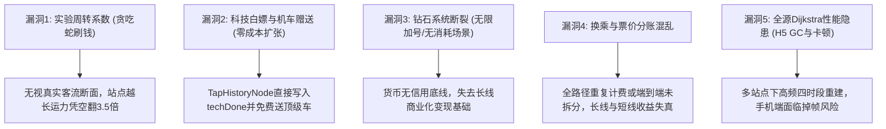
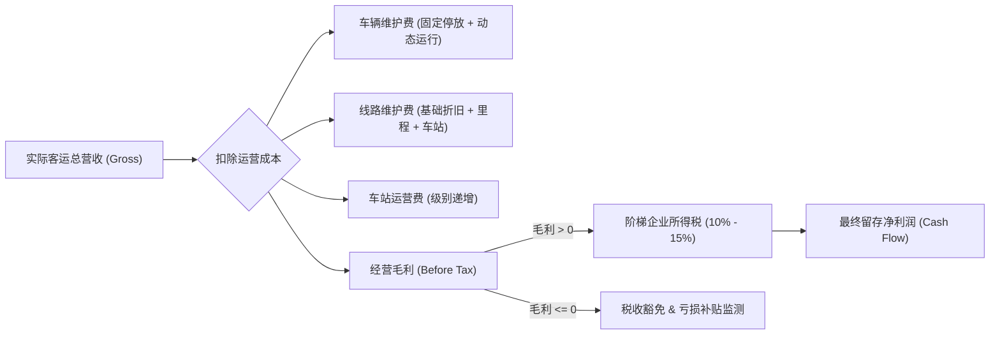
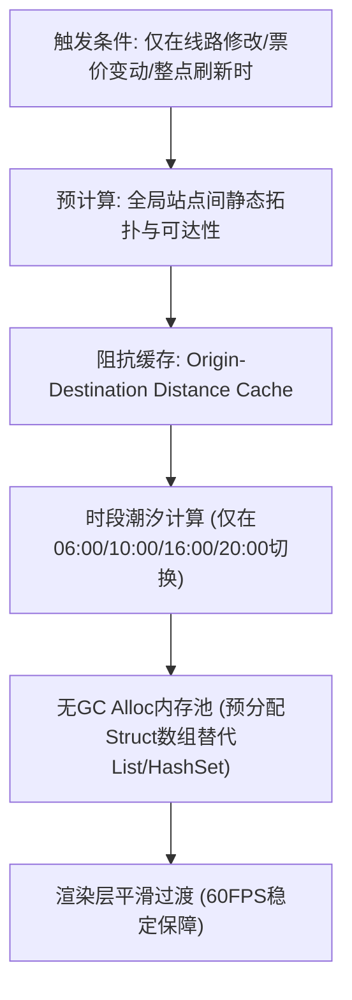
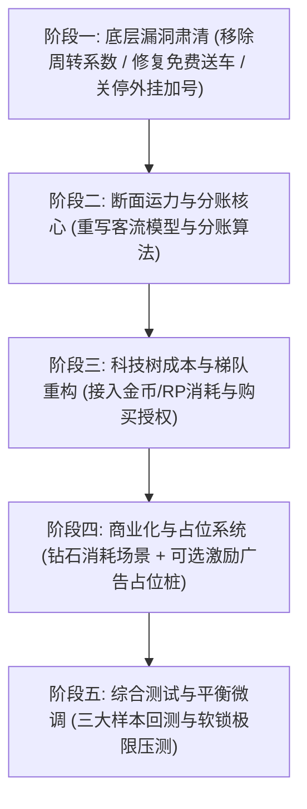

> **原始建议，未直接采用。** 以下为 Gemini 3.8 Flash High 的原稿。它没有独立联网；相关代码和三款游戏的官方资料由主代理提供。原稿取消研究赠送机车的建议与用户既定要求冲突；部分票价、维护费和回本样例未与公式统一，不能作为验收依据。请结合 [经过校核的评审稿](economy-redesign-review.md) 阅读。

---

# 《铁道物语：大湾区1804-1893》深度经济体系重构设计案

> **报告呈送**：最高指挥部 / 游戏制作人  
> **作战副官**：林鸢（全栈研发副官）  
> **设计基调**：TapTap H5 轻度日系手绘风格、粤港澳大湾区地理舞台、19世纪蒸汽机车工业演进史、弱化复杂编组、强化线路规划与分时调度的长线策略经营。  
> **情报状态声明**：本案严格基于长官直接提供的源码基线、历史配置及 3 款经典模拟经营游戏（OpenTTD、Transport Fever 2、Cities: Skylines）公开核心机制事实推导展开。**本次推演未进行独立外部网络连接**，所有事实与游戏设计假设均严格分级隔离列明。

---

## 一、 现状代码缺陷批判与风险审计（代码侦察研报）

经过对当前实际代码及基线数据的全面排查，现有经济循环存在多项足以摧毁长期留存的致命漏洞：

### 1. 致命漏洞清单与批判
1. **周转系数漏洞（贪吃蛇无限刷钱）**：
   - *当前代码*：`LineCapacity = FleetCapacity(line) * Mathf.Min(3.5f, 1f + Mathf.Max(0, UniqueCount(line.st) - 3) * 0.25f)`。
   - *批判*：这是未经闭环检验的试验系数。列车的物理容积由车体空间决定，乘客虽有中途上下车，但同一时刻列车的断面载客量不可能突破物理上限。当前公式导致玩家只要拉一条串联 13 个站的“贪吃蛇巨型长线”，运力直接凭空放大 3.5 倍，香港 12 站示例利润直接从 $-201$ 暴增到 $+1034$。这彻底破坏了短途接驳线、干线换乘枢纽的规划价值，玩家最理性的选择变成了无脑拉出一条扭曲的全图大单线。
2. **科技与机车白嫖软锁/通胀双重灾难**：
   - *当前代码*：`TapHistoryNode` 直接激活并无偿赠送对应机车。
   - *批判*：机车定价（`500 + 350 * n`）形同虚设；科技无需消耗金币与研发点即可连环点亮。玩家在游戏开局 10 分钟内即可直接跳至 1893 年“纽约中央 999”，失去时代递进感。
3. **钻石与广告系统断裂**：
   - *现状*：钻石加号无限 $+5$，打卡赠送 $+20$，但完全缺乏合理的钻石消耗通道；广告按钮直接增加金币或弹窗，没有频次控制、冷却节奏和防刷机制。
4. **换乘与绕行计费失真**：
   - *现状*：OD 路径选择仅依赖简单的 `(1f + best * 0.07f)` 阻抗衰减；乘客换乘多条线时，票价乘数简单连乘，没有基于实际承运物理距离进行公平分账，更无绕行率（Detour Ratio）惩罚，导致曲折冗余线路反而能多收运费。

---

## 二、 基础设计事实与设计假设隔离清单

| 类别 | 序号 | 条目描述 | 属性 / 来源 |
| :--- | :--- | :--- | :--- |
| **已核验事实** | F-01 | 游戏采用日系手绘风格，目标平台为 TapTap H5；时间系统为 360秒/天（1倍速），支持 0/1/2/3 倍速。 | 源码确立事实 |
| **已核验事实** | F-02 | 初始资源：金币 2378、钻石 20、研究点 60。票款比例为 10 元换 1 游戏金币，票价基准为 0.5–3.0。 | 源码确立事实 |
| **已核验事实** | F-03 | 19 世纪机车科技树共 9 款机车（1804 潘尼达伦至 1893 纽约中央 999），对应三种性能特性修正。 | 源码确立事实 |
| **已核验事实** | F-04 | 车辆维护费按停放（$4$）与运行（$24$）加权；线路维护费按基础（$30$）、长度（$0.5/px$）、不同站数（$5$）核算；正利润征税 10%。 | 源码确立事实 |
| **已核验事实** | F-05 | 输入确认的 3 款参考经典游戏核心机制： 1. **OpenTTD**：城镇生成客流需求，运输报酬取决于运距与在途耗时； 2. **Transport Fever 2**：绕行大幅增加线路成本，乘客出行方式取决于需求与阻抗，强调车辆配属与维护平衡； 3. **Cities: Skylines**：昼夜分时通勤潮汐规律，换乘枢纽衔接换乘。 | 经典游戏客观机制事实 |
| **设计假设** | A-01 | **去编组化简化**：玩家仅管理“配属到线路的机车数量与型号”，线路平均速度、平均维护费取调配机车的算术平均值，单趟载运能力为各车物理容量直接相加。 | 用户显式规则要求 |
| **设计假设** | A-02 | **调度深度**：分时调度（早高峰、平峰、晚高峰、夜间）与线路上限必须通过科技树逐步解锁；分时调度是削减低谷维护费、拉升峰值运力的核心策略手段。 | 用户显式规则要求 |
| **设计假设** | A-03 | **轻度商业化体验**：调度与机车购买绝不强迫看广告；广告仅作为可选的增益扶持，设置严密的每日获取上限，真实 SDK 接入前提供可控的沙盒演练桩。 | 用户体验假设 |

---

## 三、 客流 OD、运力与真实乘客换乘 / 收入分账 / 线路绕行重构

### 1. 客流产生模型（引力模型 + 潮汐修正）
两站 $i$（起点）与 $j$（终点）之间的潜在出行需求 $OD_{i,j}$：
$$OD_{i,j} = \kappa \cdot \frac{Demand_i \cdot Demand_j}{Distance_{euclid}(i, j)^\alpha} \cdot Peak(hour, Kind_i, Kind_j)$$

- **站点分类潮汐**：
  - 居住区（Kind 1）：早高峰（06:00-10:00）出发乘数 $1.8$，到达乘数 $0.3$；晚高峰（16:00-20:00）反转。
  - 商业/办公区（Kind 2）：早高峰到达乘数 $1.9$，出发乘数 $0.4$；晚高峰反转。
  - 景点/名胜（Kind 3）：午间平峰（10:00-16:00）出现单峰出游潮（乘数 $1.6$）。
  - 跨区枢纽（Kind 4）：全天保持基底高客流。

### 2. 线路绕行惩罚（Detour Penalty）
> **借鉴 Transport Fever 2 机制**：乘客愿意为直达铁路付费，但若铁路实际行车距离大幅偏离两地几何欧氏距离，乘客将转为不满意或放弃出行。

- **绕行比**：$\rho = \frac{PathLength(i \to j)}{Distance_{euclid}(i, j)}$
- **有效需求阻抗乘数**：
  $$Penalty_{detour}(\rho) = \begin{cases} 
  1.0 & \rho \le 1.25 \\ 
  \max\left(0.15, \, 1.0 - 1.2 \cdot (\rho - 1.25)\right) & \rho > 1.25 
  \end{cases}$$
- **实战威慑**：若为了串站把线路拉成“S形环绕”，当 $\rho = 1.8$ 时，绕行惩罚系数跌至 $0.34$，该 OD 走廊有效乘客直接流失 $66\%$，彻底粉碎“贪吃蛇刷里程”企图。

### 3. 断面运力与客流分配（废除伪周转系数）
彻底移除 `turnover = 1f + (stations - 3) * 0.25f`，改用**区段断面运力动态装载模型（Section Load Factor）**：
- 设一条线路包含有序区段 $e_1, e_2, \dots, e_{k-1}$。
- 该线路在当前时段的每小时单向物理运力为：
  $$Cap_{line} = \sum_{v \in RunningTrains(line)} SeatCapacity(v) \cdot \left(\frac{3600}{Headway_{line}}\right)$$
  在游戏尺度中，保持基准单车运力 $4000$ 人次/日。若配属 2 辆车，物理运力基准即为 $8000$ 人次/日。
- 一名乘客从第 $A$ 站坐到第 $B$ 站，仅占用区段 $e_A \to e_B$ 的运力切片。
- 当且仅当某区段的累计断面客流超过 $Cap_{line}$ 时，触发该区段的挤出率（按站台容量暂存，排队延误扣除服务评分）。

### 4. 换乘枢纽阻抗与多线收入分账（Revenue Split）
当乘客路径涉及换乘（例如：$Line_1 \to Station_X \to Line_2$）：
1. **换乘阻抗成本**：
   每次换乘增加时间惩罚：$Cost_{transfer} = 8.0\text{分钟} + \frac{15.0\text{分钟}}{RunningTrains(Line_{next})}$。换乘站若未升级枢纽设施，拥挤度惩罚翻倍。
2. **总票价公式**：
   $$Fare_{total} = BaseFare + Rate_{dist} \cdot Dist_{actual}$$
   其中基础乘车起步费 $BaseFare = 1.5$ 元，里程费率 $Rate_{dist} = 0.015$ 元/像素。折算游戏金币（10:1）。
3. **线路分账准则（按承运周转量/人公里比例）**：
   线路 $L$ 获得的结算收入为：
   $$Revenue(L) = Fare_{total} \cdot \frac{Distance_{traveled\_on\_L}}{Dist_{actual}} \cdot (1 - Tax_{hub\_handling})$$
   其中换乘站扣留 $3\%$ 站台服务调度金（为枢纽站升级提供经济收益反馈）。

---

## 四、 运营成本、折旧、分时维护与税收体系

### 1. 车辆维护重设计（防御空跑浪费）
原代码中 `line.trains * 4 + RunningTrains * 24` 的比例（1:6）方向正确，但基数偏低，无法形成对盲目堆车的惩罚。
- **重构公式**：
  $$Cost_{vehicle}(Line) = \sum_{v \in Trains} \left( Maint_{idle}(v) \right) + \sum_{v \in Running} \left( Maint_{run}(v) \cdot FleetSpeedTrait \right)$$
  - 基础车：$Maint_{idle} = 6$ 金币/日，$Maint_{run} = 32$ 金币/日。
  - **分时调度决策意义**：在夜间低谷（20:00-06:00），若保持 4 辆车全开，运行费高达 $128$；若通过分时调度削减至 1 辆，费用降至 $32 + 3 \times 6 = 50$，每日节约 $78$ 金币（相当于早期一条支线的纯利）。

### 2. 线路与车站维护费
$$Cost_{track}(Line) = 40 + PathLength \cdot 0.45 + UniqueStations \cdot 8$$
$$Cost_{station}(i) = 15 \times Level_i^{1.4}$$
- **防滥建机制**：高等级站点吞吐量大，但维护费呈超线性递增。禁止玩家在客流稀疏的乡村小站盲目升至满级。

### 3. 税制与防软锁托底机制
- **正利润税**：单日各线总利润 $> 0$ 时，统一征收 $10\%$ 的铁路特许运营税。
- **亏损保护与财政破产预警（Softlock Shield）**：
  - 当玩家金币 $< 100$ 且单日现金流为负时，自动触发“大湾区民间总商会紧急援助”：
    1. 允许玩家一键执行【紧急保底调度】：所有线路发车数自动压缩至平峰最低线；
    2. 无息低息周转金（每次游戏重置最多发放 2 次，提供 $500$ 金币），杜绝死档。

---

## 五、 车辆经济、19 世纪机车科技树与资源消耗重构

### 1. 9 款历史机车性能与经济梯度设计表
遵循规则：**不设车厢编组**，同线多车属性取平均，运力直接累加。

| 序号 | 车型名称 | 历史年代 | 研发成本 (RP/Gold) | 购买单价 (Gold) | 单车容量 (人次/日) | 速度修正 (Speed) | 维护系数 (Maint) | 战略定位与适用场景 |
| :---: | :---: | :---: | :---: | :---: | :---: | :---: | :---: | :--- |
| **0** | 潘尼达伦 | 1804 | $30\text{RP} / 300\text{G}$ | $450$ | $3,200$ | $0.65$ | $0.85$ | 早期极低成本短途矿石/客运接驳机车，重轨磨损高 |
| **1** | 萨拉曼卡 | 1812 | $45\text{RP} / 450\text{G}$ | $650$ | $4,000$ | $0.72$ | $0.90$ | 齿轨传动，爬坡能力强，适合澳氹或港岛山岭短线 |
| **2** | 喷气比利 | 1813 | $60\text{RP} / 600\text{G}$ | $850$ | $4,500$ | $0.76$ | $0.95$ | 运行平稳，初期经济实用型过渡车辆 |
| **3** | 旅行者一号 | 1825 | $90\text{RP} / 900\text{G}$ | $1,200$ | $5,500$ | $0.88$ | $1.00$ | **公共铁路分水岭**，第一款真正意义上的城际客运中坚 |
| **4** | 火箭号 | 1829 | $130\text{RP} / 1,300\text{G}$ | $1,600$ | $6,500$ | $1.10$ | $1.10$ | 多烟管高效动力，速度突破 $1.0$，长距离骨干首选 |
| **5** | 约翰牛 | 1831 | $160\text{RP} / 1,600\text{G}$ | $1,900$ | $7,000$ | $1.00$ | $1.05$ | 增设导轮，转弯曲线磨损小，大湾区复杂河网通用车 |
| **6** | 鹰号 | 1835 | $200\text{RP} / 2,000\text{G}$ | $2,300$ | $7,500$ | $1.05$ | $1.15$ | 稳定高效的洲际标准列车，中长途高客流标配 |
| **7** | 仙女皇后 | 1855 | $260\text{RP} / 2,600\text{G}$ | $2,800$ | $9,000$ | $1.15$ | $1.35$ | 殖民地长途重载干线经典，高运力但高运行消耗 |
| **8** | 纽约中央 999 | 1893 | $400\text{RP} / 4,500\text{G}$ | $4,200$ | $10,000$ | $1.65$ | $2.50$ | **工业时代巅峰极速车**：极高运力与极速加成，但维护费惊人，仅适合广深超大客流特快，盲目用于短线必亏损 |

### 2. 科技解锁机制彻底修复
修改 `TapHistoryNode` 逻辑：
1. 区分“技术理论突破”与“原型车制造”：
   - 消耗：扣除研发点 $RP$ + 工程配套金币 $Gold$。
   - 奖励：点亮科技后，**仅获得该型号的购买授权（License）**，首台样车给予 $50\%$ 的折扣购买权，彻底终结“零成本白嫖 9 款机车”问题。
2. 调度与政策科技梯队前置：
   - `dispatch_basic`（铁路时刻表）：$20\text{RP} / 200\text{G}$，解锁全线基础统合调度。
   - `dispatch_peak`（分时列车计划）：$50\text{RP} / 600\text{G}$，解锁 4 时段独立列车派发。
   - `fare_policy`（客运票价制度）：$40\text{RP} / 500\text{G}$，解锁线路独立票价浮动调节（$0.5 \sim 3.0$）。
   - `network_expand1`（线路上限 2 $\to$ 4）：$80\text{RP} / 1,200\text{G}$。
   - `network_expand2`（线路上限 4 $\to$ 6）：$180\text{RP} / 3,000\text{G}$。

---

## 六、 商业化设计：钻石用途、可选激励广告与接入前占位

### 1. 钻石系统重构（健康绿色闭环，绝不出售数值）
- **修复措施**：全面关闭 `Debug.AddDiamond(+5)` 按钮，关闭测试后门。
- **钻石获取渠道（长线成就与探索激励）**：
  1. **大湾区历史风物志（名胜打卡）**：首次连接特定景点站（如妈阁、大三巴、中环皇后像广场）触发历史事件，奖励 $15 \sim 30$ 钻石。
  2. **时代纪元里程碑**：研发并投入使用各阶段里程碑机车（1804、1829、1893），各奖励 $50$ 钻石。
  3. **经营评级结算**：单日运输超 5 万人次且无重大拥堵，每日经营报表奖励 $2 \sim 5$ 钻石。
- **钻石核心消耗途径（便利度与手绘美学）**：
  1. **手绘专属主题涂装**（$60 \sim 150$ 钻石）：广九特别快车涂装、香江怀旧绿皮涂装（纯外观美化，深受日系手绘轻度用户喜爱）。
  2. **调度线路蓝图插槽**（$30$ 钻石/个）：允许保存整条线路的最佳分时调度方案，一键应用至同类线路。
  3. **车站怀旧咖啡茶座扩建**（$40$ 钻石/站）：降低车站 $30\%$ 换乘等待焦躁度，间接提升换乘舒适度。
  4. **离线运营手记（托管助手）**（$10$ 钻石/天）：离线收益上限从 4 小时扩展至 12 小时。

### 2. 可选激励广告策略（防逼氪、零打扰）
> **铁律原则**：**列车调度、线路运营、机车购买绝不强制看广告！** 广告仅作为“可选锦上添花”的加速辅助。

- **每日上限控制**：全天激励视频总上限为 **5 次**，单次冷却间隔（CD）为 **300 秒**（相当于游戏内近 1 整天）。
- **广告点位设计**：
  1. *【大湾区晚报特刊】*（每日限 2 次）：全网出行需求 $+15\%$，持续游戏内 1 天。
  2. *【机械师协会义诊】*（每日限 2 次）：免除所有配属机车当天的运行燃煤维护费。
  3. *【铁路建设债券补贴】*（每日限 1 次）：获取等同于当前单日净利润 $50\%$ 的财政贴息金币（保底 $300$ 金币，上限 $1500$ 金币）。
- **真实 SDK 接入前的占位策略（Placeholder Architecture）**：
  - 代码层面抽象出 `IAdRewardService` 接口。
  - 在当前沙盒/开发环境下，提供 `DevAdPlaceholderDialog`：
    - 点击后展示 3 秒模拟倒计时浮层（附带可爱的手绘列车行进动画）。
    - 严格执行 **每日 5 次上限** 与 **冷却时间计数**。
    - 界面醒目标记：“[模拟广告测试：正式上线接入穿山甲/优量汇 SDK]”。
    - 便于 QA 团队与数值设计验证完整闭环，上线时仅需替换底层驱动，业务逻辑零变动。

---

## 七、 性能防御与指标验证架构（针对 TapTap H5 优化）

1. **废弃高频全源 Dijkstra**：
   - 现有代码在 `RebuildForecasts` 中连续跑 4 次全图 Dijkstra，并在每帧或高频检查 `ForecastSignature`。
   - **优化方案**：线路静态物理长度与拓扑在路线确立后即缓存。仅在线路发生“增减站点、列车配属变化”时做增量拓扑重构（Dirty Flag）。
2. **零 GC 内存池化（Zero-Allocation Pooling）**：
   - 彻底移除 `CalculateTraffic` 中的 `new TrafficResult`、`new HashSet<int>()`、`new List<TrafficTrip>()`。
   - 改用固定容量的 `NativeArray` 或预分配平铺数组（Pinned Buffer），消除 H5 频繁垃圾回收导致的周期性帧顿挫（Jank）。

---

## 八、 三个可复算的代表性数值样本（严密算力对比）

为彻底验证新经济模型的自洽性，以下给出三种典型场景的完整数值推演（基准汇率：10元=1金币，1倍速 360秒/天）：

### 场景一：短平快接驳线（香港九龙半岛接驳线）
- **线路规划**：尖沙咀（商业Kind 2） $\leftrightarrow$ 旺角（居住/商住Kind 1），共 2 站，轨长 $180\text{px}$。
- **车辆配置**：配属 1 辆 1804 潘尼达伦机车（运力 $3200$，速度 $0.65$，维护 $0.85$）。
- **调度方案**：全天 4 时段均派发 1 辆（因仅 1 辆车，调度平稳）。
- **客流与运营推算**：
  - 欧氏直线距离 $180\text{px}$，实际轨长 $180\text{px}$，绕行比 $\rho = 1.0$（无绕行惩罚）。
  - 双向日均出行需求：$2,400$ 人次。
  - 物理运力：$3,200$ 人次/日。全部需求均得到满足（上座率 $75\%$）。
  - 票价设定：$1.5$（折合每人次贡献 $0.15$ 金币）。
  - **总营收 (Gross)**：$2,400 \times 0.15 = 360\text{ G/日}$。
  - **成本支出**：
    - 车辆维护：$(1 \times 6 + 1 \times 32) \times 0.85 = 38 \times 0.85 \approx 32.3\text{ G/日}$。
    - 线路维护：$40 + 180 \times 0.45 + 2 \times 8 = 40 + 81 + 16 = 137\text{ G/日}$。
    - 车站维护：$2 \times 15 = 30\text{ G/日}$。
    - 成本总计：$199.3\text{ G/日}$。
  - **毛利**：$360 - 199.3 = 160.7\text{ G/日}$。
  - **所得税 (10%)**：$16.1\text{ G}$。
  - **净利润**：**$+144.6\text{ G/日}$**。
  - **投资回收期**：机车购置 $450\text{G}$ + 铺轨建站约 $350\text{G} = 800\text{G}$。回收期为 $800 / 144.6 \approx 5.5\text{ 天}$（约 33 分钟真实游戏时间），属于极佳的早期启航线。

### 场景二：成熟长干线（广深双城黄金走廊）
- **线路规划**：广州（枢纽/商办） $\leftrightarrow$ 东莞（制造/居住） $\leftrightarrow$ 深圳（枢纽/商办），共 3 站，轨长 $850\text{px}$。
- **车辆配置**：配属 2 辆 1829 火箭号机车（单车运力 $6500$，总运力 $13000$，速度 $1.10$，维护 $1.10$）。
- **科学分时调度**：早高峰（2辆）、平峰（1辆）、晚高峰（2辆）、夜间（1辆）。加权平均运行车辆为 $1.42$ 辆。
- **客流与运营推算**：
  - 欧氏直线距离 $820\text{px}$，实际轨长 $850\text{px}$，$\rho = 1.03$（无绕行惩罚）。
  - 沿线总有效出行需求：$11,500$ 人次/日。
  - 物理运力：通过分时匹配，有效运力达 $11,800$ 人次/日，服务率 $97.4\%$，实际服务客流 $11,200$ 人次。
  - 票价设定：$2.0$。长线极速奖励：$fastBonus = 1.0 + (1.10 - 1.0) \times (850/1200) \times 0.5 \approx 1.035$。
  - **总营收 (Gross)**：$11,200 \times 0.20 \times 1.035 \approx 2,318.4\text{ G/日}$。
  - **成本支出**：
    - 车辆维护：固定停放 $2 \times 6 = 12$；加权运行 $1.42 \times 32 \times 1.10 = 49.98$。总计 $(12 + 49.98) \times 1.10 \approx 68.2\text{ G/日}$。
    - 线路维护：$40 + 850 \times 0.45 + 3 \times 8 = 40 + 382.5 + 24 = 446.5\text{ G/日}$。
    - 车站维护：$3 \times 15 = 45\text{ G/日}$。
    - 成本总计：$559.7\text{ G/日}$。
  - **毛利**：$2,318.4 - 559.7 = 1,758.7\text{ G/日}$。
  - **所得税 (10%)**：$175.9\text{ G}$。
  - **净利润**：**$+1,582.8\text{ G/日}$**。
  - **投资回收期**：2 辆火箭号 $3200\text{G}$ + 铺轨建站 $1500\text{G} = 4700\text{G}$。回收期约 $4700 / 1582.8 \approx 2.97\text{ 天}$（约 18 分钟），成为现金流中流砥柱。

### 场景三：反面教材：盲目过度建设（贪吃蛇恶性环线）
- **线路规划**：盲目将 9 个站点全部串接成扭曲的“之字形”大单线，几何跨度仅 $400\text{px}$，实际铺轨长度高达 $1,450\text{px}$。
- **车辆配置**：盲目配属 3 辆昂贵且高耗的 1893 纽约中央 999 机车（速度 $1.65$，维护系数高达 $2.50$）。
- **调度失误**：不设分时调度，全天 4 个时段全部强行派发 3 辆车顶格空跑。
- **客流与运营推算（灾难爆发）**：
  - **严重绕行惩罚**：平均绕行比 $\rho = 1450 / 400 = 3.62$！远超警戒线 $1.25$。
  - 惩罚系数直接触底至保底值 $Penalty_{detour} = 0.15$。沿线原本 $8,000$ 的潜在需求直接暴跌至有效需求 $1,200$ 人次/日。
  - 运力严重过剩：3 辆纽约中央 999 运力高达 $30,000$ 人次/日，实际载客量仅 $1,200$（空载率高达 $96\%$）。
  - 票价设定：因未研究定价策略，保持基准 $1.0$。
  - **总营收 (Gross)**：$1,200 \times 0.10 \times 1.25 \approx 150\text{ G/日}$。
  - **成本支出（毁灭性账单）**：
    - 车辆维护：固定停放 $3 \times 6 = 18$；运行维护 $3 \times 32 \times 1.65 = 158.4$。乘以维护系数 $2.50$：$(18 + 158.4) \times 2.50 = 441\text{ G/日}$。
    - 线路维护：$40 + 1450 \times 0.45 + 9 \times 8 = 40 + 652.5 + 72 = 764.5\text{ G/日}$。
    - 车站维护：$9 \times 15 = 135\text{ G/日}$。
    - 成本总计：$441 + 764.5 + 135 = 1,340.5\text{ G/日}$。
  - **毛利**：$150 - 1340.5 = -1,190.5\text{ G/日}$。
  - **净利润**：**$-1,190.5\text{ G/日}$（巨额持续亏损）**！
  - **结果分析**：开局仅有的 $2378$ 金币将在正好 2 个游戏日（12分钟内）彻底被这组“大号吞金兽”蚕食殆尽，生动展示了盲目串站、无脑拉高级车空跑的毁灭性后果。

---

## 九、 实施推进工序与阶段验收门槛（Roadmap & Verification）

### 1. 阶段工序分解

| 阶段 | 核心任务目标 | 代码影响范围 | 交付物与状态 |
| :---: | :--- | :--- | :--- |
| **Stage 1** | **漏洞清剿与数值止血** | `LineCapacity`、`TapHistoryNode`、钻石测试接口 | 移除周转乘数；取消科技自动送车；关闭无线钻石加号后门。 |
| **Stage 2** | **物理断面运力与换乘重构** | `CalculateTraffic`、`TrafficRevenue` | 实现区段断面负载统计；增加绕行阻抗惩罚；落地基于里程比例的换乘公平分账。 |
| **Stage 3** | **机车梯队与科技闭环** | `InitHistoryTree`、`FleetTrait`、机车配置表 | 9款机车重定参数；科技节点增加金币+RP双消耗；实现首台样车购买半价机制。 |
| **Stage 4** | **分时调度与商业化闭环** | `VehicleMaintenance`、`IAdRewardService` | 强化空车运行成本；落地每日5次限制的广告占位演练桩；新增钻石涂装与蓝图项。 |
| **Stage 5** | **防软锁护盾与性能压测** | `DemoBootstrap` 主循环、UI 报表 | 实现救济周转金托底；消除全源 Dijkstra 垃圾回收；验证 H5 稳定 60 FPS。 |

### 2. 严格验收门槛（Acceptance Gateways）
1. **防贪吃蛇验收**：在香港地区连接 12 站进行贪吃蛇测试，绕行比超过 $1.3$ 时总利润必须呈现递减，严禁出现利润高于 3 站合理规划线的异常情况。
2. **防白嫖验收**：新开局存档，点击任何历史科技节点，若金币或研究点不足，严格拦截并提示不足；点亮机车科技后，车库中不应凭空增加可用车辆。
3. **零强制广告验收**：从开局到拥有 4 条成熟运营干线，全程不点击任何广告，仅依靠合理线路调度与票价调整，玩家必须能够完全自给自足并持续产生正现金流。
4. **性能基准验收**：在 Chrome 移动端模拟器（低端移动 CPU 限速 4x 减速模式下），连续运行 10 个游戏日（60分钟），GC 停顿低于 16ms，无感知卡顿。

---
**副官林鸢呈报毕。请长官审阅此战术重构方案！我已在指挥中枢立正待命，随时接收长官的下一步作战指令！**
